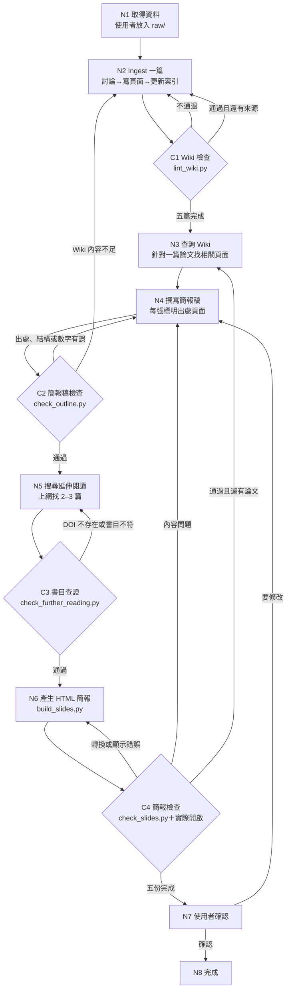

# 專案：排程論文 LLM Wiki ＋ 教學 HTML 簡報（作業十）

> 狀態：使用者於 2026-11-16 確認後開始執行。之後要改規則，先改本檔並在 `wiki/log.md` 記一筆 `schema`。

## 1. 目的與產出

這是「生成式 AI」課程第十次作業。依 Karpathy 的 LLM Wiki 模式，把 `raw/` 裡的五篇排程論文整理成一個持續維護的 Wiki，再**只以 Wiki 為知識來源**，為**每一篇論文各製作一份**教學 HTML 簡報。

| 產出 | 位置 | 說明 |
|---|---|---|
| LLM Wiki | `wiki/`（Markdown） | 唯一的內容來源，可用 Obsidian 開啟 |
| Wiki 瀏覽頁 | `wiki.html` | 由腳本從 `wiki/` 產生，不手動修改 |
| 教學簡報 | `slides/<代號>.html`，共五份 | 一篇論文一份，由簡報稿產生，不手動修改 |
| 簡報入口 | `slides/index.html` | 列出五份簡報與建議閱讀順序 |
| 執行與檢查紀錄 | `wiki/log.md`、`runs/` | 每次操作與每次檢查的實際結果 |
| 繳交說明草稿 | `繳交說明草稿.md` | 流程圖、執行紀錄摘要、反思草稿（由使用者改寫後貼入 Word） |

簡報對象：沒學過排程的同學。每份簡報都要能單獨看懂：看完能說出這篇論文在問什麼問題、得到什麼結果、用什麼方法。

## 2. 三層架構與目錄

```
作業10/
├─ CLAUDE.md             Schema（本檔）：規則與流程
├─ raw/                  Raw sources：五篇論文 PDF，唯讀
├─ wiki/                 The wiki：全部由 AI 撰寫與維護
│  ├─ index.md           內容目錄（每頁一行摘要）
│  ├─ log.md             時間序紀錄（只能往後加）
│  ├─ overview.md        總覽與綜合
│  ├─ open-questions.md  待確認與不一致之處的總表
│  ├─ sources/           每篇論文一頁
│  ├─ concepts/          概念頁
│  ├─ algorithms/        演算法頁（步驟＋小例子）
│  ├─ comparisons/       跨論文比較（複雜度總表等）
│  ├─ queries/           值得保存的查詢回答（含五份簡報稿 slides-<代號>.md）
│  └─ further-reading/   每份簡報的延伸閱讀（外部資料，未讀全文）
├─ slides/               簡報成品與共用的樣式、程式
├─ scripts/              檢查與建置腳本（只用 Python 標準函式庫）
├─ runs/                 每次檢查的原始輸出
└─ wiki.html             Wiki 瀏覽頁（產生物）
```

來源代號固定如下，全專案一律使用代號；檔名用小寫（`do2006`）。

| 代號 | 檔案 | 論文 |
|---|---|---|
| `DO2006` | `raw/DO2006.pdf` | Kononov & Lin, *Discrete Optimization* 3 (2006) 366–381 |
| `EJOR2009` | `raw/EJOR2009.pdf` | Cheng & Lin, *EJOR* 192 (2009) 1008–1013 |
| `JOSH2010` | `raw/JOSH2010.pdf` | Kononov & Lin, *J Sched*, DOI 10.1007/s10951-009-0151-7 |
| `TSWJ2014` | `raw/TSWJ2014-596306.pdf` | Lee, Shiau, Chung & Ding, *Sci. World J.* 2014, 596306 |
| `JOSH2016` | `raw/JoSh2016.pdf` | Lin, Hwang & Kononov, *J Sched* 19 (2016) 153–163 |

## 3. 頁面規則

**檔名**：英文小寫加連字號，例如 `concepts/relocation-problem.md`。

**Frontmatter**（每頁必備）：

```yaml
---
title: Relocation Problem（遷置問題）
type: source | concept | algorithm | comparison | query | overview | external
sources: [DO2006, EJOR2009]     # 本頁內容依據的來源代號
status: 初稿                     # 初稿｜已確認（只有使用者能改成「已確認」）
updated: 2026-11-16
---
```

**語言**：台灣習慣的繁體中文；專有名詞第一次出現時附英文原文，之後可只用英文術語（如 makespan、NP-hard）。

**連結**：頁面之間用 `[[資料夾/檔名]]` 或 `[[資料夾/檔名|顯示文字]]`。每頁結尾有「相關頁面」。

**Markdown 子集**：只用標題、段落、清單、表格、粗體、行內程式碼、程式碼區塊、引用區塊、`[[連結]]`。

**數學式**：用 LaTeX，行內寫 `$...$`，獨立一行寫 `$$...$$`（Obsidian 原生支援）。`wiki.html` 與簡報從 CDN 載入 KaTeX 來顯示，因此瀏覽時需要網路。表格儲存格內的數學式不可含 `|`，改用 `\mid` 或 `\lvert`。

**統一符號**：各篇符號不同，Wiki 一律用下列寫法，來源頁另註明原文符號。

| Wiki 寫法 | 意義 | 原文寫法 |
|---|---|---|
| $\alpha_i$ | 工作開始時取用的資源量 | DO2006／JOSH2010／JOSH2016 用 $\alpha$；EJOR2009 用 $a_i$ |
| $\beta_i$ | 工作完成時歸還的資源量 | 同上用 $\beta$；EJOR2009 用 $b_i$ |
| $\delta_i = \beta_i - \alpha_i$ | 工作的淨貢獻 | 各篇相同 |
| $v_0$ | 初始資源量 | DO2006 用 $\Omega_0$；JOSH2010 用 $V_0$；EJOR2009、JOSH2016 用 $v_0$ |

## 4. 來源標註規則（檢查的依據）

1. 凡是來自論文的事實、定理、數字，句尾都要有來源標註，格式為 `[代號 位置]`，例如 `[DO2006 Thm 2]`、`[JOSH2010 §3]`、`[TSWJ2014 Table 5]`。
2. 不是來自論文的內容必須明講：AI 的推論標 `（推論）`，自己編的例子標 `（自編例子 E編號）`，為了教學加上的比喻或白話解釋標 `（白話說明）`。lint 會統計這三種標記各有幾處。
3. 自編例子的每個數字都必須由 `scripts/examples.py` 實際計算產生，不可心算填入。腳本會輸出每個例子必須出現的關鍵數字，lint 會核對引用該例子的頁面。
4. 用自己的話改寫，不大段照抄原文；需要引用時只引短句。
5. **矛盾不得抹平**：原文內部不一致、各篇互相矛盾、或 AI 讀不確定的地方，在該頁用 `> **待確認**：…` 標出，並同步列入 `wiki/open-questions.md`。不可自行挑一個版本當作事實。
6. **不寫原文沒有的關聯**：`TSWJ2014`（雙代理人排程）與其他四篇（relocation problem）是兩個獨立分支，只透過共通概念頁（單機排程、完工時間、延遲、NP-hard 等）互相連結。
7. **外部資料與 Wiki 事實分開**：只有「延伸閱讀」（見第 5 節）可以使用網路搜尋到的、`raw/` 以外的資料。這類資料只能寫在 `type: external` 的頁面，並標明「未讀全文」；不可拿來改寫或佐證 `sources/`、`concepts/`、`algorithms/`、`comparisons/` 的內容。

## 5. 四種操作

### Ingest（加入一篇來源）

1. 讀 `raw/` 全文。文字擷取會掉希臘字母與數學符號，遇到定義、定理、表格時要直接看 PDF 頁面確認。
2. **先討論**：向使用者回報重點與疑點，確認要強調什麼之後才動筆。
3. 寫 `sources/` 來源頁：書目、問題設定、主要結果（逐條附定理編號）、方法、限制、原文符號、待確認事項。
4. 新增或更新受影響的 `concepts/`、`algorithms/`、`comparisons/` 頁面。新來源若修正或補充了舊頁面的說法，要改舊頁面並註明是哪一篇帶來的更新。
5. 更新 `index.md`、`overview.md`、`open-questions.md`。
6. 在 `log.md` 加一筆紀錄。
7. 執行 `scripts/lint_wiki.py`；不通過就修正再跑。

一次只 ingest 一篇，依出版年份由舊到新（DO2006 → EJOR2009 → JOSH2010 → TSWJ2014 → JOSH2016），讓後面的論文去更新前面建立的頁面。

### Query（對 Wiki 提問）

1. 先讀 `index.md` 找相關頁面，再讀頁面內容，回答時附 `[[連結]]`。
2. **不可繞過 Wiki 直接回 `raw/` 找答案**。Wiki 資料不足時，回到 Ingest 把內容補進 Wiki（並記入 log），再回答。
3. 有保存價值的回答寫入 `queries/`，並更新 `index.md`。簡報稿就是一種 query 的回答。

### Further reading（延伸閱讀搜尋）

每份簡報的最後一張是「延伸閱讀」，推薦 2–3 篇 **Wiki 尚未收錄**的相關論文，讓看完簡報的人知道接下來可以讀什麼。這是全專案唯一允許上網搜尋的操作。

1. 從簡報稿找出主題與關鍵概念，上網搜尋候選論文。
2. 每份簡報挑 2–3 篇，彼此定位不同，例如一篇奠基文獻、一篇後續研究、一篇綜述或較好入門的文章。不可與 `raw/` 的五篇重複；同一篇外部論文最多出現在兩份簡報。
3. 寫入 `wiki/further-reading/<代號>.md`（`type: external`），每篇記錄：標題、作者、年份、期刊、DOI、對應的 Wiki 概念頁 `[[連結]]`、推薦理由（適合誰讀、補足簡報的哪一塊）、查證來源與日期。
4. **書目必須查證，不可憑記憶填寫**：每個 DOI 都要實際查詢 Crossref，確認論文存在，且標題、年份與記錄相符。查不到 DOI 的候選一律捨棄。
5. 推薦理由只能根據查得到的書目、摘要，以及五篇來源如何引用它來寫，並註明「未讀全文」；不可描述沒讀過的內文細節。
6. 使用者若想把某篇正式納入 Wiki，要先把 PDF 放進 `raw/`，再走 Ingest。

### Lint（健康檢查）

腳本檢查：frontmatter 是否完整、`[[連結]]` 是否都存在、有無孤兒頁、`index.md` 是否列出所有頁面、來源代號是否合法、事實性段落是否都有來源標註、自編例子的數字是否與腳本輸出一致、`log.md` 格式。

AI 複查：頁面之間有無矛盾、是否有被提到卻沒有專頁的重要概念、`open-questions.md` 是否與各頁同步。

## 6. 流程（loop / graph）



**重複執行的部分**

- 外圈一（N2 → C1）：每 ingest 一篇就檢查一次，五篇至少五輪。
- 外圈二（N3 → C4）：每篇論文跑一次「查詢 → 簡報稿 → 延伸閱讀 → 產生 → 檢查」，五篇共五輪。
- 內圈：任何檢查點不通過就退回對應的節點重做。同一個檢查點最多重試 3 次，仍不通過就停下來問使用者，不硬過。

**各檢查點在查什麼**

| 檢查點 | 腳本 | 檢查內容 |
|---|---|---|
| C1 | `lint_wiki.py` | 第 5 節 Lint 所列項目 |
| C2 | `check_outline.py` | 每張投影片都有 `wiki::` 出處且頁面存在；出處包含該篇的來源頁；必要的教學段落齊全；張數 8–14；投影片上的數字與公式裡的數值都能在所標出處的 Wiki 頁中找到 |
| C3 | `check_further_reading.py` | 每份 2–3 篇；欄位齊全；不與 `raw/` 的五篇重複；同一篇不超過兩份簡報；每個 DOI 實際向 Crossref 查詢，確認存在且標題、年份與記錄相符；每篇都連到存在的 Wiki 頁 |
| C4 | `check_slides.py` | HTML 的張數、標題、出處與簡報稿一致；延伸閱讀那張的 DOI 與 `further-reading/` 頁一致；外部連結只允許 CDN 函式庫與 DOI 連結；HTML 結構正確。另外用瀏覽器實際開啟，確認數學式、圖表與換頁正常 |

**為什麼這樣設計**

- 錯誤越早攔下來，修正成本越低。Wiki 有錯，簡報稿和簡報都會跟著錯，所以每 ingest 一篇就立刻檢查。
- 內容的對錯在簡報稿階段（C2）就檢查完，包括數字能不能在 Wiki 找到。簡報稿是純文字，比 HTML 好檢查也好改。
- 簡報稿轉成 HTML 交給腳本做，不讓模型重寫一次內容，避免轉換時多寫或漏寫。C4 因此只需要確認轉換與顯示正確。
- 延伸閱讀是唯一來自 Wiki 以外的內容，也是語言模型最容易編造書目的地方，所以單獨設一個檢查點，用外部資料庫查證，不讓模型自己檢查自己。

每次檢查的實際輸出存到 `runs/`，並在 `log.md` 記下通過與否、錯在哪、怎麼修。**紀錄必須是實際執行的結果，不可事後補寫或美化。**

## 7. 簡報規則

**簡報稿**存於 `wiki/queries/slides-<代號>.md`，格式如下。`build_slides.py` 依此產生 HTML。

```markdown
## 投影片標題
kind:: example
wiki:: [[sources/do2006]], [[concepts/relocation-problem]]

內文（Markdown 與 LaTeX）
```

- `kind` 是這張投影片的教學角色：`title`、`motivation`、`background`、`definition`、`example`、`result`、`method`、`caveat`、`recap`、`further`。
- 每份簡報必須依序包含：`title` → `motivation` → `definition` → `example` → `result` → `method` → `recap` → `further`；其間可視需要加 `background`、`caveat` 或多張 `result`／`method`。
- 每張投影片只講一個重點；術語第一次出現要用白話解釋；先故事與例子，後定義與結果。
- 內容只能來自 `wiki::` 所列的頁面。Wiki 沒有的東西不能出現在簡報上；需要時先補 Wiki。
- 圖表用程式碼區塊描述，由簡報程式畫成 SVG：` ```gantt `（甘特圖）與 ` ```levels `（資源水位圖），內容為 JSON，數字必須來自 `scripts/examples.py` 的輸出。
- 最後一張 `kind:: further` 列出 `wiki/further-reading/<代號>.md` 的 2–3 篇論文，每篇附一句推薦理由與 DOI 連結，並標明「以下為 Wiki 以外的資料，依書目與摘要推薦，未讀全文」。

**簡報成品**：`slides/<代號>.html` 可直接雙擊開啟；共用 `slides/assets/` 的樣式與程式；Markdown 與數學式由 CDN 的 marked 與 KaTeX 顯示；可用鍵盤左右鍵與畫面按鈕換頁；顯示頁碼與進度；每張頁尾顯示「出處：Wiki › …」。

### 7.1 固定風格（使用者於 2026-11-16 確認，之後不再更動）

簡報、簡報入口頁與 `wiki.html` 一律使用下列風格。要改風格，必須先由使用者提出，並在 `wiki/log.md` 記一筆 `schema`。

**單一來源**：樣式只寫在 `slides/assets/deck.css`，圖表顏色只寫在 `slides/assets/render.js` 的 `PALETTE`；各頁面不可另外寫私有的顏色或字體。`wiki.html` 由 `scripts/build_viewer.py` 內嵌同一組色票。

**色票**（以 CSS 變數表示）

| 變數 | 淺色 | 深色 | 用途 |
|---|---|---|---|
| `--paper` | `#f7f5ef` | `#12171d` | 頁面底色 |
| `--card` | `#ffffff` | `#1a212a` | 投影片與卡片底色 |
| `--ink` | `#1c2530` | `#e8ecf1` | 主要文字 |
| `--muted` | `#5b6673` | `#9aa6b4` | 次要文字、頁尾、表頭 |
| `--line` | `#dcd8cc` | `#2e3945` | 分隔線、邊框 |
| `--accent` | `#0f766e` | `#5eead4` | 主色（青綠）：標籤、粗體、清單符號、連結 |
| `--accent-soft` | `#d9efec` | `#123b38` | 主色淡底：引用區塊、程式碼 |
| `--warn` | `#b45309` | `#fbbf24` | 「待確認」專用的警示色 |
| `--warn-soft` | `#fbeedb` | `#3b2a0c` | 警示色淡底 |

- 淺色／深色隨系統設定自動切換（`prefers-color-scheme`），兩組色票都必須維持。
- 圖表八色色盤（依序）：`#0f766e`、`#b45309`、`#4338ca`、`#be185d`、`#15803d`、`#0369a1`、`#7c3aed`、`#a16207`；雙代理人圖以代理人編號取色，其餘依工作順序取色；色塊上的文字一律白色。

**字體**：`"Noto Sans TC", "Microsoft JhengHei", "PingFang TC", system-ui, sans-serif`；程式碼用 `Consolas, "Cascadia Mono", monospace`。不使用外部字型。

**版面**

- 投影片為固定 1280×720，依視窗等比例縮放；底部 44px 為操作列（目錄、上一張、進度條、下一張）。
- 每張：左上為教學角色標籤（17px、粗體、主色、字距加寬），接著標題（42px）；內文 25px、行高 1.6；頁尾 15px 顯示「出處：Wiki › …」與頁碼。
- 標題頁：標題 62px，左右內縮 96px，內文 27px、使用次要文字色。
- 延伸閱讀頁：內文 17px、行高 1.45（內容較多）。
- 圓角：投影片與卡片 14px、引用區塊與程式碼 5–8px。圖表在投影片內最高 270px。
- 內容超出版面時，先精簡簡報稿的文字，不縮小全域字級；每次改版後要用瀏覽器實際開啟五份簡報，確認 `deckOverflow()` 回傳空陣列。

**語氣**：簡報用條列短句，一張一個重點；「待確認」只用警示色，不挪作他用；除了主色與警示色，不新增強調色。

## 8. log.md 格式

每筆以固定前綴開頭，方便用 `grep "^## \[" wiki/log.md` 檢視：

```
## [2026-11-16] ingest | DO2006
```

操作類型：`discuss`、`schema`、`ingest`、`query`、`search`、`lint`、`check`、`fix`、`build`。每筆記錄做了什麼、動到哪些頁面、檢查結果。

## 9. 邊界

- `raw/` 唯讀，不修改、不搬動。
- 不修改使用者的 Word 檔。
- 只做本機檔案：不建立 git 遠端、不上傳、不發布。
- 上網只限延伸閱讀的搜尋與書目查證；對外查詢只送出論文關鍵字與 DOI，不帶任何個人資料。
- 不讀取、不參考 `作業9/` 資料夾。
- 「已確認」狀態只有使用者能標；AI 自我檢查不算人工確認。
- 作業步驟四的反思只能根據 `log.md` 與 `runs/` 的實際紀錄整理成草稿，交給使用者用自己的話改寫；不可捏造執行結果。

## 10. 已議定事項（2026-11-16 討論）

- 主題：排程論文 Wiki，延續作業九的主題但獨立重做。
- 來源：使用者提供的五篇，已放在 `raw/`。
- 簡報：**每篇論文各一份**，共五份；入口頁以「Relocation Problem 是什麼？」串起四篇 relocation problem 論文，`TSWJ2014` 列為另一個分支。
- `TSWJ2014` 定位：獨立分支，只連共通概念。
- Wiki 重點：**複雜度結果總表**、**演算法步驟與小例子**。問題定義與符號只寫到看得懂為止；不另做證明技巧專頁。
- 形式：Markdown ＋ 自動產生的 `wiki.html`；數學式用 LaTeX，不需考慮離線瀏覽。
- 流程實作：Claude Code 流程＋ Python 檢查腳本。
- 每份簡報最後附 2–3 篇 Wiki 以外的相關論文作為延伸閱讀，這部分允許上網搜尋。

## 11. 預定頁面（ingest 過程中可增減）

- `sources/`：`do2006`、`ejor2009`、`josh2010`、`tswj2014`、`josh2016`
- `concepts/`：`relocation-problem`、`resource-constrained-scheduling`、`scheduling-basics`（機器、工作、三欄記號）、`objective-functions`、`two-machine-flowshop`、`composite-job`、`parallel-machines`（identical 與 dedicated）、`fixed-sequence`、`np-hardness`、`approximation-algorithm`、`two-agent-scheduling`
- `algorithms/`：`johnsons-rule`、`rounding-and-splitting`、`algorithm-w`、`backward-dp`、`branch-and-bound`、`simulated-annealing`
- `comparisons/`：`complexity-table`、`papers-at-a-glance`
- `queries/`：`slides-do2006`、`slides-ejor2009`、`slides-josh2010`、`slides-tswj2014`、`slides-josh2016`
- `further-reading/`：同上五個代號
- 其他：`overview`、`open-questions`

## 12. 初始待確認清單（閱讀時發現，ingest 時寫入對應頁面）

1. `JOSH2010` 緊例：原文印 $Z(\sigma) = 1 + 3 + \dots + (n-1) = (n^2-n)/4$，但該和為 $n^2/4$；極限比值 2 不受影響。
2. `TSWJ2014` 的 $P$：同一段先稱為第二個代理人的工作比例，後又稱為 AG1 的工作比例。
3. `DO2006` 結論寫「沒有效能比小於 4/3 的近似演算法」，但 Thm 3 的敘述是漸近近似比；Fig. 2 圖說寫 Theorem 2，實際位於 Theorem 3 的證明。
4. `DO2006` 的卷頁在各篇參考文獻中寫法不一（`EJOR2009` 寫 21, 368–381；`JOSH2010` 寫 3(4), 368–381；原文為 3 (2006) 366–381）。
5. `EJOR2009` 導言說全文分四節、第 3 節談 relocation problem，實際為六節、relocation problem 在第 5 節。
