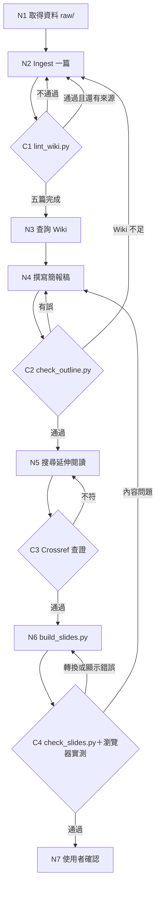

# 作業十 繳交說明草稿

> 這是整理給你改寫的草稿，數字都來自 `wiki/log.md` 與 `runs/` 的實際紀錄。步驟四「反思」請用你自己的話重寫；我只列出事實與可以怎麼說。

標題格式：陽明交大 314706031 資管碩二 簡逸昇 作業十（主題：排程論文 LLM Wiki）

## 1. LLM Wiki 主題與簡短介紹

主題是我碩士論文會用到的**排程論文**：以 relocation problem（資源限制下的遷置排程）為主線，另有一篇雙代理人排程。依 Karpathy 的 LLM Wiki 模式，由 AI 依 `CLAUDE.md` 的規則撰寫與維護，我負責提供來源、討論重點、審閱。

- 先討論、後生成：AI 讀完五篇後先回報重點與疑點，我決定「雙代理人那篇獨立成分支」「重點放在複雜度總表與演算法步驟」；`CLAUDE.md` 經我確認、並依我的要求修改兩次（數學式用 LaTeX；每份簡報加延伸閱讀；每篇各做一份簡報）才開始生成。
- ingest 5 篇：DO2006、EJOR2009、JOSH2010、TSWJ2014、JOSH2016（放在 `raw/`，唯讀）。
- 成果：38 頁 Wiki（來源 5、概念 11、演算法 6、比較 2、簡報稿 5、延伸閱讀 5、總覽與待確認 2、目錄與紀錄 2）。

## 2. LLM Wiki 成果

- 瀏覽頁：`wiki.html`（雙擊開啟，需要網路以載入數學式）；原始內容在 `wiki/`（可用 Obsidian 開）。
- 規則：`CLAUDE.md`；操作紀錄：`wiki/log.md`；待確認事項：`wiki/open-questions.md`（12 項，最初只有 5 項，其餘是 ingest 時才發現）。
- 目前只做本機檔案，沒有公開連結。若老師要求連結，需要你決定發布方式。

## 3. 教學 HTML 簡報

每篇論文一份，入口是 `slides/index.html`：

| 簡報 | 張數 |
|---|---|
| `slides/ejor2009.html` Relocation Problem 是什麼？從 Johnson's rule 看起 | 9 |
| `slides/do2006.html` 多個工作隊：人手變多，問題反而變難 | 10 |
| `slides/josh2010.html` 重要的工作先做？資源說了算 | 10 |
| `slides/josh2016.html` 順序都定好了，還有什麼好決定？ | 9 |
| `slides/tswj2014.html` 兩位客戶共用一台機器（另一個分支） | 10 |

每份都是：動機 → 定義 → 例子 → 結果 → 方法 → 回顧 → 延伸閱讀。每張頁尾的「出處」可點回 Wiki 頁面，Wiki 與簡報的對應是機器可查的（`data-wiki`）。最後一張是 Wiki 以外的 3 篇論文，書目用 Crossref 查證過，未讀全文。

## 4. loop / graph 設計

- **重複的部分**：外圈一（N2→C1）每篇論文一輪；外圈二（N3→C4）每份簡報一輪；任何檢查不過就退回前一個節點，同一檢查點最多重試 3 次。
- **資訊怎麼流**：論文 → Wiki（每句事實附 `[代號 位置]`，自編例子標 E 編號，數字由 `examples.py` 計算）→ 簡報稿（每張標 `wiki::` 出處）→ 腳本轉成 HTML（模型不重寫內容）。
- **為什麼這樣設計**：越早攔下錯誤越便宜；內容對錯在純文字的簡報稿階段檢查完（包含數字能不能在 Wiki 找到），HTML 階段只檢查「轉換有沒有忠於簡報稿」；延伸閱讀是唯一來自 Wiki 以外的內容，也是模型最容易編造書目的地方，所以單獨設查證關卡，由外部資料庫核對，不讓模型自己檢查自己。

## 5. 一次實際執行的檢查紀錄

共產生檢查紀錄：C1 11 份、C2 6 份、C3 5 份、C4 10 份（含不通過的），原始輸出在 `runs/`，彙整在 `wiki/log.md`。

| 檢查點 | 不通過／有問題的紀錄 |
|---|---|
| C1 | DO2006 第 1 輪：5 項（1 項頁面格式、4 項是檢查工具認不得的寫法）；TSWJ2014 第 1 輪：1 項（定位說明沒有來源標註） |
| C1（工具本身） | 一次「通過」是無效的：修改檢查腳本時正規表示式被改壞，重跑卻顯示通過；另一次 lint 抓不到 `\theta` 被寫成 Tab＋`heta` |
| C2 | TSWJ2014：2 項（多放一列圖表資料、教學結構順序錯）；其餘四份一次通過 |
| C3 | 15 個 DOI 全部通過（候選本來就是用 Crossref 搜到的，這關是確認，沒有攔截到錯誤） |
| C4 | ejor2009、josh2010：DOI 含括號被 Markdown 連結截斷；瀏覽器實測：2 張內容超出版面（腳本看不出） |

另外做了兩個「檢查檢查工具」的測試：`scripts/selftest.py`（故意做一個含 12 種錯誤的小 Wiki，確認 lint 全抓得到）與 C2 的負向測試（塞一個 Wiki 沒有的數字，確認被擋下）。

## 6. 反思（草稿，請用你自己的話改寫）

**哪個節點最常出錯？** 依紀錄，不是內容，而是「檢查本身」：C1 的 lint 腳本。它兩次出問題（正規表示式被改壞導致無效的通過、抓不到壞掉的 LaTeX），而且兩次都是寫完後主動回頭看檔案才發現的，不是檢查回報的。內容方面，最常被擋下的是「格式／對應」類錯誤（C1 的來源標註、C2 的圖表資料與結構、C4 的連結轉換），而不是模型講錯論文內容。

**把檢查往前移到哪裡？** 兩件事，要誠實區分：

1. 實際出事後才移的：新增 `selftest.py`，讓檢查腳本在每次修改後先用一份「已知有錯」的資料自我測試，等於把「檢查是否可信」的檢查放到所有檢查之前；lint 新增控制字元檢查。
2. 一開始設計時就決定、不是出事後才移的：把「數字能不能在 Wiki 找到」從最後的簡報檢查提前到簡報稿階段（C2）。這個設計是否有效，C2 的負向測試證明數字核對有作用，但這次執行中沒有真的靠它擋下過編造的數字。

**有沒有修改 workflow / graph？** 有：流程圖從初稿的三個檢查點，改成四個（新增 C3 書目查證），並把簡報稿改成由腳本轉 HTML；C4 增加「用瀏覽器實際開啟」，因為腳本檢查看不出內容超出版面。

**誠實的限制**（交作業前建議保留）：
- 沒有任何一篇延伸閱讀讀過全文，推薦理由只依書目、標題與五篇來源的引用。
- Wiki 與簡報的內容正確性，除了「數字能在 Wiki 找到」與「來源標註格式」之外，主要仍靠 AI 自己對照原文；Wiki 全部標為「初稿」，12 項待確認事項需要你對照原文。
- 12 項待確認中，有些是原文的筆誤（例如 JOSH2010 緊例的封閉式），我只標出，沒有替原文決定對錯。

## 你需要做的事

1. 對照原文看 `wiki/open-questions.md` 的 12 項，決定哪些要採信；確認過的頁面才由你把 status 改成「已確認」。
2. 瀏覽 `wiki.html` 與 `slides/index.html`，看內容是否符合你的課堂簡報預期。
3. 用你自己的話改寫第 6 節，並貼進 Word；若需要公開連結，決定發布方式。
